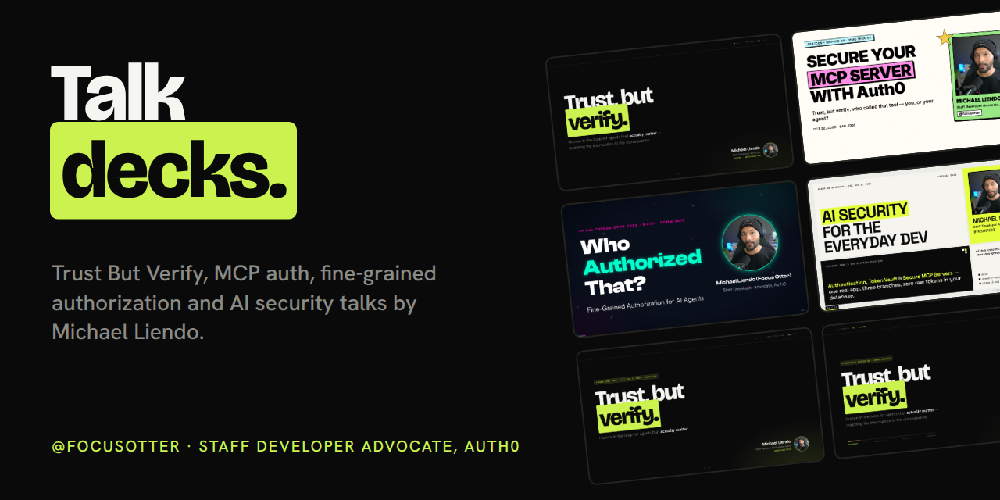
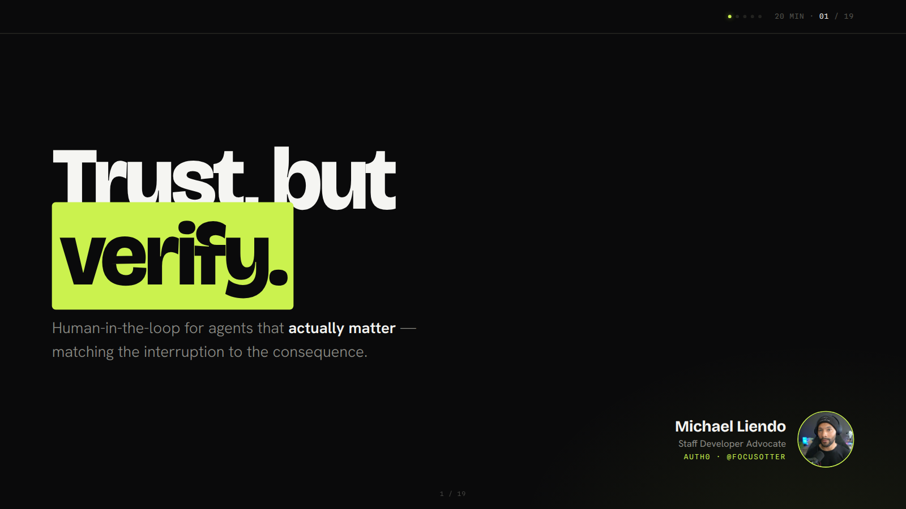
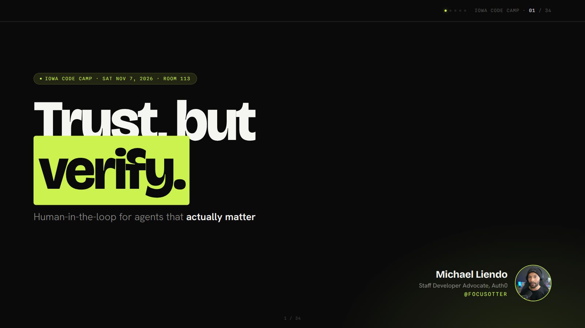
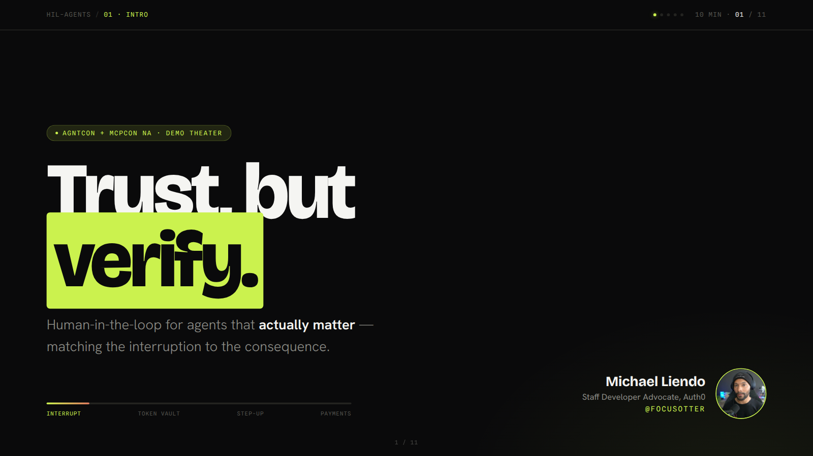
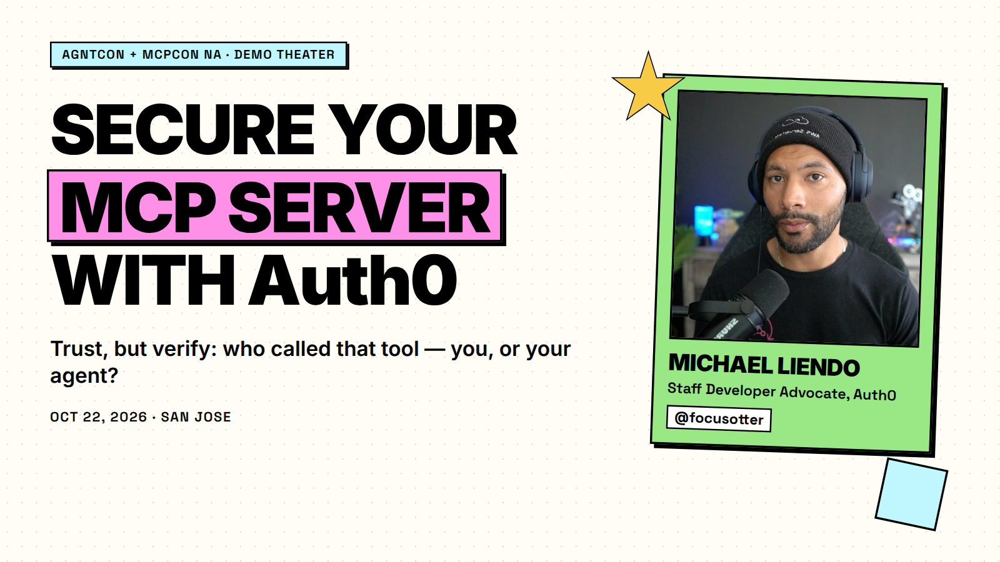
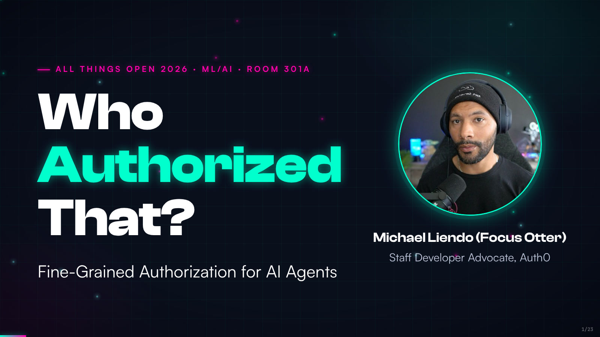
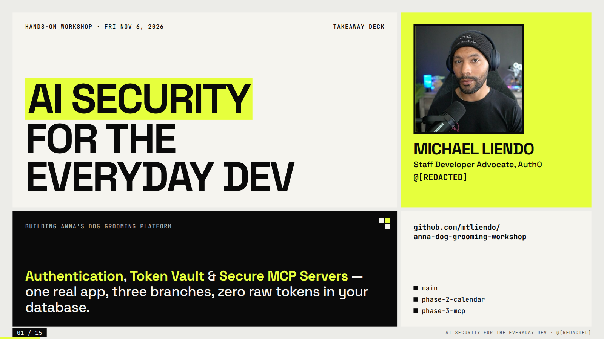
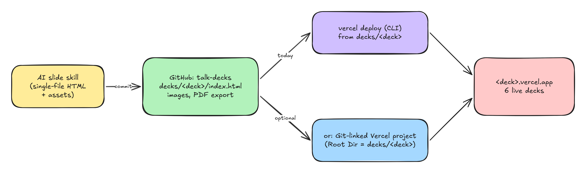

# Talk Decks

Michael Liendo's ([@focusotter](https://x.com/focusotter)) conference talk decks: Trust But Verify (human-in-the-loop for agents), securing MCP servers with Auth0, fine-grained authorization for AI agents, and AI security for everyday devs.



Each deck is a self-contained static site (one `index.html` plus its images, and a PDF export where one exists), generated with an AI slide skill and deployed to Vercel with the CLI. Until now, the Vercel deployments were the only copy. This repo is the backup and the source of truth from here on.

## Decks

| Deck | Event | Live | Folder |
| --- | --- | --- | --- |
| Trust, But Verify | AI Engineer 2026 | [trust-but-verify-aie.vercel.app](https://trust-but-verify-aie.vercel.app) | [`decks/trust-but-verify-aie`](decks/trust-but-verify-aie) |
| Trust, But Verify | Iowa Code Camp, Nov 7 2026 | [trust-but-verify-iowa.vercel.app](https://trust-but-verify-iowa.vercel.app) | [`decks/trust-but-verify-iowa`](decks/trust-but-verify-iowa) |
| Trust, But Verify (HITL for Agents) | AGNTCon + MCPCon NA, Demo Theater | [hitl-talk-deck.vercel.app](https://hitl-talk-deck.vercel.app) | [`decks/hitl-talk-deck`](decks/hitl-talk-deck) |
| Secure Your MCP Server with Auth0 | AGNTCon + MCPCon NA, Oct 22 2026, San Jose | [mcp-talk-deck.vercel.app](https://mcp-talk-deck.vercel.app) | [`decks/mcp-talk-deck`](decks/mcp-talk-deck) |
| Who Authorized That? FGA for AI Agents | All Things Open 2026 | [who-authorized-that-deck.vercel.app](https://who-authorized-that-deck.vercel.app) | [`decks/who-authorized-that-deck`](decks/who-authorized-that-deck) |
| AI Security for the Everyday Dev | Hands-on workshop, Nov 6 2026 | [ai-security-workshop-deck.vercel.app](https://ai-security-workshop-deck.vercel.app) | [`decks/ai-security-workshop-deck`](decks/ai-security-workshop-deck) |

| | |
| --- | --- |
|  |  |
|  |  |
|  |  |

## Architecture



Source: [`docs/architecture.excalidraw`](docs/architecture.excalidraw) (open it at [excalidraw.com](https://excalidraw.com) to edit; rendered with the `@excalidraw/excalidraw` npm package).

## Working with a deck

Preview locally:

```sh
npx serve decks/mcp-talk-deck
```

Redeploy to its existing Vercel project (team "Focus Otter's projects"):

```sh
cd decks/mcp-talk-deck
vercel link --project mcp-talk-deck   # first time only
vercel deploy --prod
```

To deploy from Git instead, connect the Vercel project to this repo and set its Root Directory to `decks/<deck>`.

## How this backup was made

Every file was pulled from the latest READY production deployment of each Vercel project and checked against the SHA-1 that Vercel records for it, so the files here match the files deployed, byte for byte.

| Vercel project | Deployment | Deployed |
| --- | --- | --- |
| trust-but-verify-aie | `dpl_6kSx5EzHaJ3paC4See6VSqqBgSbK` | 2026-11-12 |
| trust-but-verify-iowa | `dpl_BnT9tFjvsJgMzjQkgCErkx7GQPDZ` | 2026-11-07 |
| hitl-talk-deck | `dpl_4xuKG5dr57bRnMaNRdmo6ysAeUWS` | 2026-10-22 |
| mcp-talk-deck | `dpl_14pB4zdmBX1S3xskx68T4ynVBxE6` | 2026-10-22 |
| who-authorized-that-deck | `dpl_4Wr86EWySQ55GsfEhrCHW9at1wJ9` | 2026-10-20 |
| ai-security-workshop-deck | `dpl_Gwd1GfBnyiW64YwZHwmSmnwYoV8s` | 2026-11-06 |
